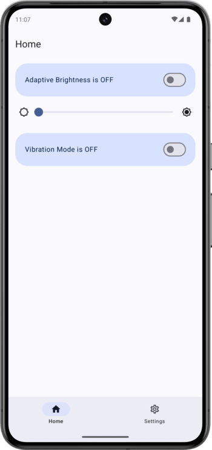
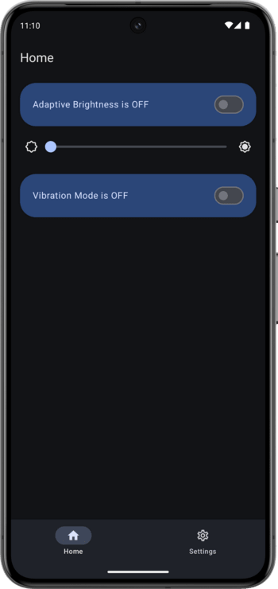
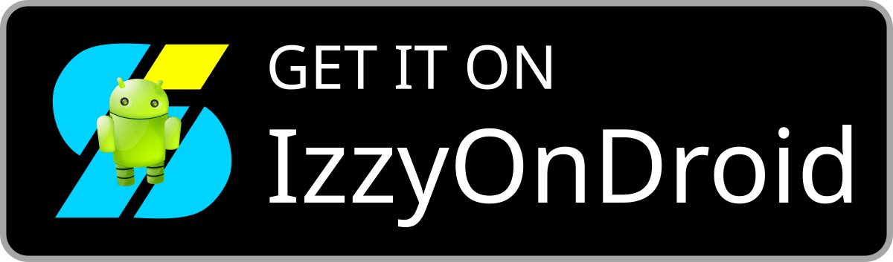

<div style="text-align: center;">
  
  <br>
  <span style="font-size: 30px;">Cerberus Tiles</span>
</div>

<p style="text-align: center;">
  <a href="https://app.codacy.com/gh/JoestarLabs/CerberusTiles/dashboard?utm_source=gh&utm_medium=referral&utm_content=&utm_campaign=Badge_grade"></a>
  <a href="https://github.com/JoestarLabs/CerberusTiles/actions/workflows/tests.yaml"></a>
  <a href="https://github.com/JoestarLabs/CerberusTiles/actions/workflows/codeql.yml"></a>
  <a href="https://github.com/JoestarLabs/CerberusTiles/releases"></a>
  <!-- Started counting 2025-07-28 -->
  <a href="https://hits.sh/github.com/JoestarLabs/CerberusTiles/"></a>
  <a href="https://shields.rbtlog.dev/com.bl4ckswordsman.cerberustiles"></a>
  <!-- <a href="https://github.com/bl4ckswordsman/CerberusTiles/"></a> -->
  <!-- <a href="https://hits.seeyoufarm.com/api/count/graph/dailyhits.svg?url=https://github.com/bl4ckswordsman/CerberusTiles"> -->
  <!--  -->
  <!-- Added 2024-02-14. This count views instead of visitors like the previous one did. Removed 2025-06-14 -->
</p>

## Introduction

Pixel phones don't offer quick access to some core settings, unlike some other Android phone
manufacturers.

That's where Cerberus Tiles[^1] comes in, to add more quick settings tiles and shortcuts to your
Google Pixel.
Ideal to be used with the back tap gesture.
Tested in a Pixel 8 Pro.

<details>
  <summary> Screenshots (Click to expand)</summary>

<p>
  
  
  

</p>
</details>

## Features

|                                              | In-app toggle | App shortcut | Quick Settings tile |
|:--------------------------------------------:|:-------------:|:------------:|:-------------------:|
|             Adaptive Brightness              |       ✅       |      ✅       |          ✅          |
|            Vibration Ringer Mode             |       ✅       |      ✅       |          -          |
|                Overlay dialog                |       -       |      ✅       |          -          |
| Limit Charge to 80%<br>*(requires adb perm)* |       ✅       |      -       |          -          |
|                 Smart Pixels                 |       ✅       |      -       |          ✅          |

> [!NOTE]
> More features coming soon.

<!-- PERMISSIONS_START -->
## Permissions & Privacy

Cerberus Tiles operates with **zero internet access**, **zero analytics**, and **zero tracking**. All permissions are strictly optional and only prompted when you choose to enable the corresponding feature.

| Permission | Feature | Why It Is Needed | How It Is Granted |
| :--- | :--- | :--- | :--- |
| **Write System Settings** | Adaptive Brightness, Ringer Mode | Toggles device brightness mode and ringer/vibration states. | Standard system settings screen |
| **Notification Policy (DND)** | Vibration Ringer Mode | Prevents system crashes when switching ringer mode while Do Not Disturb is active. | Standard system settings screen |
| **Write Secure Settings** | Limit Charge to 80% | Modifies the system charge_optimization_mode setting on Pixel devices. | One-time ADB command |
| **Accessibility Service** | Smart Pixels | Draws a hardware-accelerated true-black pixel grid over the display without blocking touch interaction. | Accessibility Settings |

### Frequently Asked Questions

<details>
  <summary><strong>Why does Smart Pixels require an Accessibility Service?</strong></summary>

  To save battery on OLED displays, Smart Pixels renders an overlay of blacked-out pixels across the screen.
  - Using standard screen overlays (`TYPE_APPLICATION_OVERLAY`) causes Android to block touch inputs in secure apps (like GitHub, banking apps, and system dialogs) due to tapjacking protection (`filterTouchesWhenObscured`).
  - An Accessibility Overlay (`TYPE_ACCESSIBILITY_OVERLAY`) is treated by Android as a trusted visual layer, allowing 100% transparent touch pass-through across all apps and system bars.
</details>

<details>
  <summary><strong>Why does Android warn that the app has "full control of your device"?</strong></summary>

  This is Android's mandatory, static system warning shown for *all* accessibility services regardless of their actual declared capabilities. Cerberus Tiles' service is strictly hardened:
  - `canRetrieveWindowContent="false"`: Cannot read screen content, text, or passwords.
  - `canPerformGestures="false"`: Cannot simulate clicks, gestures, or taps.
  - `canRequestFilterKeyEvents="false"`: Cannot log or intercept keystrokes.
  - `canRequestTouchExplorationMode="false"`: Cannot intercept touch exploration.
  - **Zero Event Types**: Does not receive or listen to window or UI events.
</details>

<details>
  <summary><strong>How do I grant the Charging Optimization permission?</strong></summary>

  The 80% charging limit modifies an Android secure system setting, which requires granting permission once via ADB:
  ```bash
  adb shell pm grant com.bl4ckswordsman.cerberustiles android.permission.WRITE_SECURE_SETTINGS
  ```
</details>

<details>
  <summary><strong>Does Cerberus Tiles collect any personal data?</strong></summary>

  No. The app does not request `INTERNET` permission in its manifest and has no ability to send data anywhere. Everything runs strictly on your device.
</details>
<!-- PERMISSIONS_END -->

## Download

Download a GitHub Actions build (scanned by 🛡VirusTotal) here:
<p>
  <a href="https://github.com/JoestarLabs/CerberusTiles/releases/latest"></a>
</p>

Or from IzzyOnDroid:
<p>
  <a href="https://apt.izzysoft.de/packages/com.bl4ckswordsman.cerberustiles"></a>
</p>

### Kudos to

- [This cool Gradient Generator](https://doodad.dev/gradient-generator/) used in the app icon.
- [sameerasw/essentials](https://github.com/sameerasw/essentials) (Sameera Sandakelum) for the Smart Pixels feature and pattern rendering algorithm, licensed under the MIT License.

[^1]: Name inspired by the multi-headed hound of Hades that guards the underworld.
